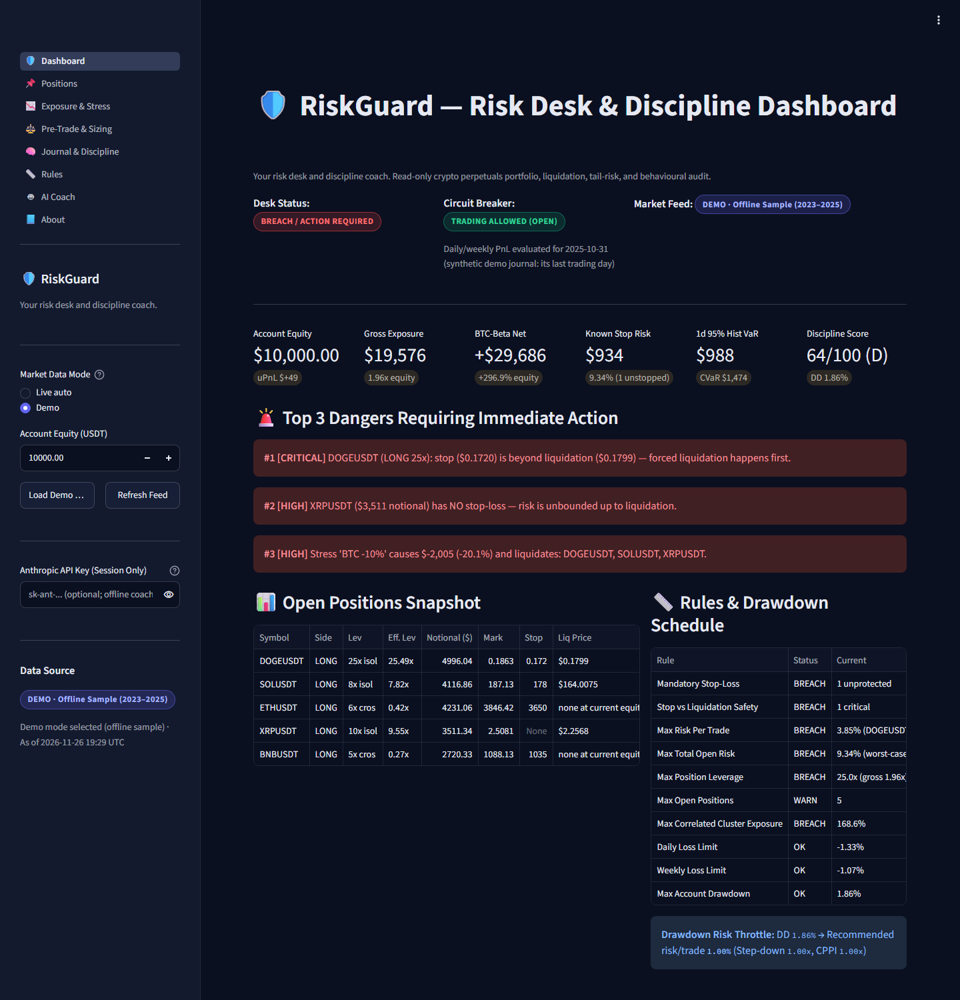
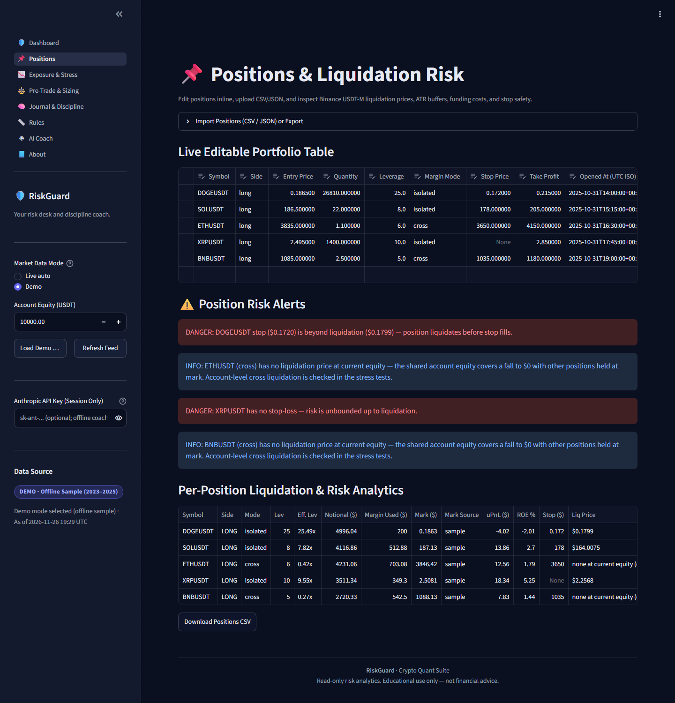
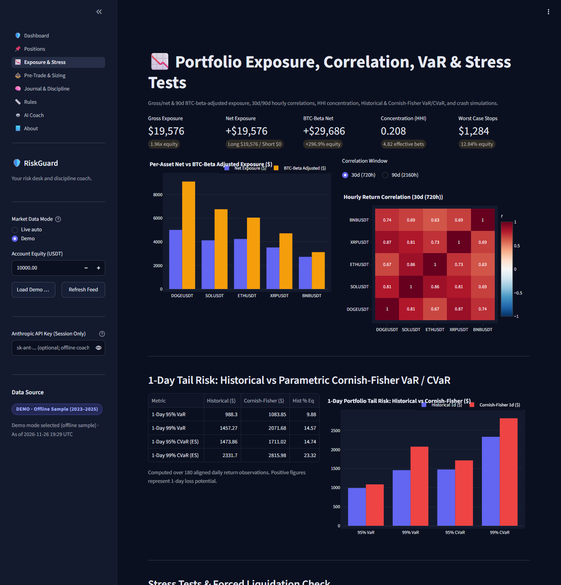
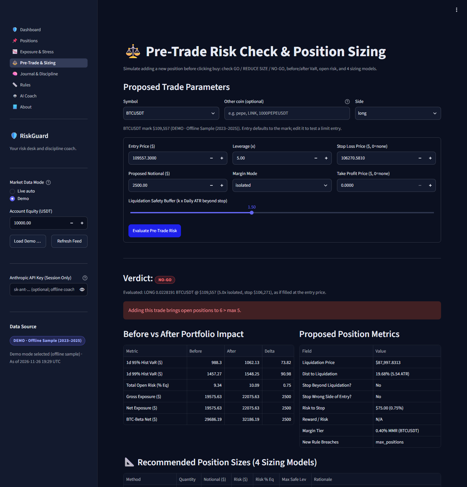
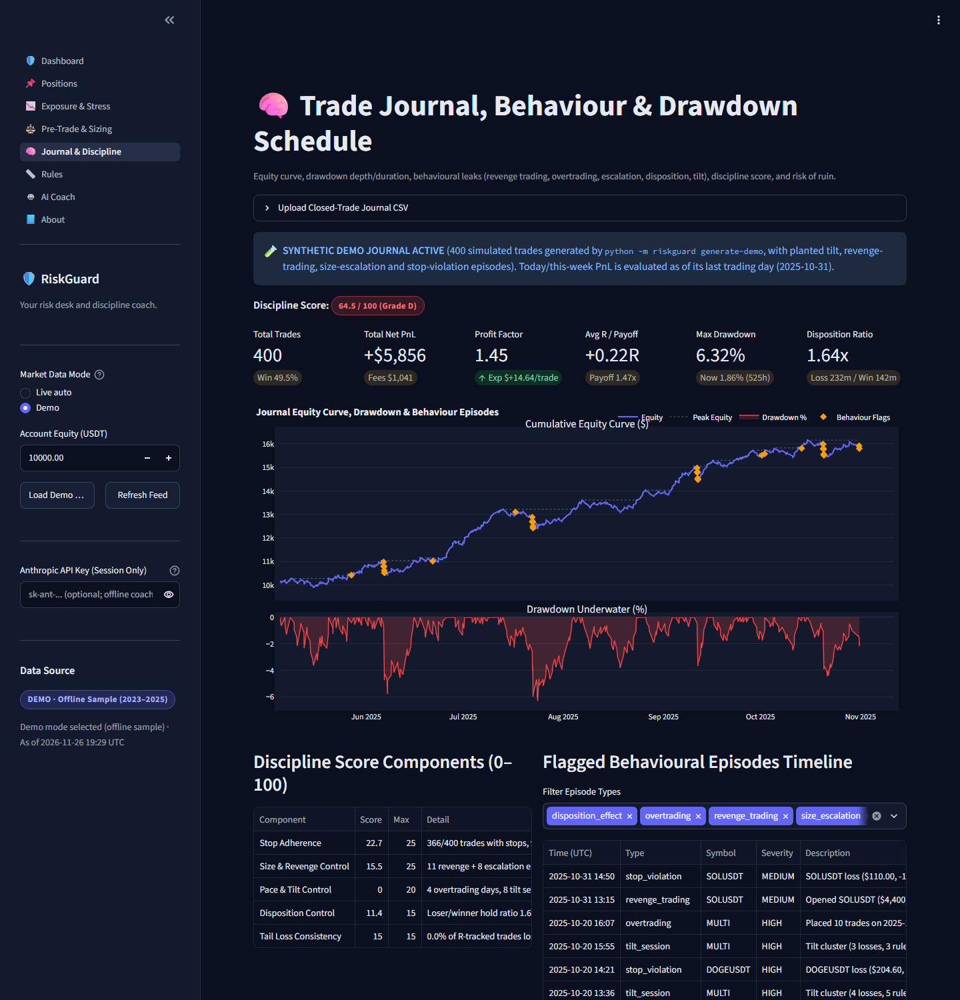
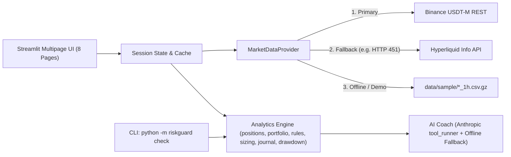

# 🛡️ RiskGuard

**Your risk desk and discipline coach.**

RiskGuard is an open-source, read-only Python & Streamlit risk analytics workbench for crypto perpetual futures traders. Paste or upload your open perpetual positions and closed-trade journal to audit liquidation risk, portfolio exposure, correlations, tail risk (Historical & Cornish-Fisher VaR/CVaR), crash stress tests, risk rules, position sizing, behavioural leaks, and drawdown risk schedules — backed by an optional Claude AI Coach with deterministic offline fallback.

---

## Screenshots

Real screenshots of the running app (headless Chromium, default settings, no API key).


<sub>Dashboard: desk status, top dangers, rules and drawdown schedule</sub>

| | |
|---|---|
| <br><sub>Positions: exact liquidation prices, stop-vs-liquidation checks</sub> | <br><sub>Exposure & stress: correlation, BTC-beta, VaR, crash scenarios</sub> |
| <br><sub>Pre-trade check and sizing models</sub> | <br><sub>Journal: discipline score and behaviour flags</sub> |
| <br><sub>AI Coach review (offline mode shown)</sub> |  |

---

## Why Traders Blow Up

Most perpetual accounts do not blow up from a bad entry signal — they blow up from four compounding risk failures:

1. **Stops Beyond Liquidation:** High isolated leverage places your liquidation price *closer* to entry than your stop-loss, guaranteeing forced liquidation before your stop ever triggers.
2. **Hidden Directional Correlation:** Holding five simultaneous altcoin longs is not diversification; in a market sell-off, pairwise correlations spike toward `1.0` and your effective BTC-beta exposure multiplies.
3. **Fat-Tailed Drawdowns:** Crypto daily returns exhibit negative skewness and high excess kurtosis, causing Gaussian VaR to underestimate crash risk.
4. **Behavioural Tilt:** Revenge trading after a loss, size escalation across losing streaks, widening stops, and holding losers longer than winners turn survivable drawdowns into account ruin.

---

## Core Features

- **Per-Position Risk & Binance USDT-M Liquidation Formula:** Supports **any Binance USDT-M perpetual coin** — notional, margin used, effective leverage, unrealized PnL, risk-to-stop (`$` & `%` equity), R:R, daily funding cost estimate (longs pay positive funding), maintenance-margin tier lookup with continuous `cumB` (showing the tier table used, e.g. `_DEFAULT (default)` for coins without symbol-specific brackets), liquidation price (`LP`), distance to liquidation (`%` and daily ATR multiples), mark-source / entry-proxy flags for any symbol unavailable on the active feed, and `DANGER` flags when a stop sits beyond liquidation, is missing, or has already been crossed by the mark (an unprotected position, reported as unbounded risk, not $0). A cross position whose shared equity covers a fall to $0 is shown as "none at current equity (cross)"; account-level cross liquidation is still checked in the stress tests.
- **Portfolio Exposure, Correlation & Tail Risk:** Gross/net exposure, per-asset breakdown, 90d hourly BTC-beta-adjusted exposure, 30d & 90d hourly correlation heatmaps, HHI concentration, 1-day 95%/99% Historical & Cornish-Fisher VaR/CVaR, worst-case stop risk, and 6 stress tests (`BTC -5/-10/-20%`, `Alt Crash 1.5x BTC`, `Correlation -> 1` in whichever direction hurts the book, `Funding Spike`) with isolated and account-level cross liquidation checks.
- **Pre-Trade Check & Sizing Calculator:** Simulates adding a trade in any bundled or custom Binance USDT-M coin via the **Other coin** input (resolves short tickers like `pepe` to the active contract such as `1000PEPEUSDT`/`PEPEUSDT` against cached Binance `/fapi/v1/exchangeInfo` in Live mode, or `^[A-Z0-9]{2,20}USDT$` format in offline Demo mode; warns clearly in Demo mode when Live mode is needed for prices while still letting you evaluate on an entered entry price). Evaluated as if filled at its entry price (`GO` / `REDUCE SIZE` / `NO-GO` verdict, before/after VaR, open risk, exposure, rule breaches, recommended quantity/leverage, margin tier used) alongside 4 sizing methods: Fixed Fractional, ATR Volatility-Targeted, Capped Fractional Kelly, and Max-Leverage-Safe (keeping liquidation `k` ATRs beyond your stop).
- **Rules Engine & Circuit Breaker:** Configurable YAML/UI limits (risk per trade, total open risk, leverage, daily/weekly loss, max drawdown, max positions, correlated cluster exposure, mandatory stop) with OK / WARN / BREACH status and a `"Trading Allowed Today?"` circuit breaker. A real journal is evaluated against today's date; the bundled synthetic demo journal is evaluated as of its last trading day.
- **Trade Journal, Behavioural Detectors & Discipline Score (0–100):** Equity curve, drawdown depth/duration, R distribution, breakdowns by symbol/weekday/hour, plus detectors for **revenge trading**, **overtrading**, **size escalation**, **disposition effect**, **stop violations**, and **tilt sessions**.
- **Drawdown Risk Schedule & Risk of Ruin:** Step-down table, CPPI-style cushion multiplier, analytical root-solved Risk of Ruin, and Monte Carlo flat vs scheduled risk simulations (same ruin definition in every estimate: equity falls a set % below its starting value).
- **AI Risk Coach (Claude + Offline Fallback):** Tool-calling AI coach (`anthropic` 2.x `tool_runner` with 8 `@beta_tool` closures returning compact JSON) that inspects live portfolio/stress/rule/journal state, cites concrete metrics, prioritizes the biggest dangers first, and falls back to a deterministic offline briefing when no API key is set, on any Anthropic SDK error, or on a refusal.
- **Resilient Market Data Pipeline:** Binance USDT-M REST (`/fapi/v1/premiumIndex`, `/fapi/v1/ticker/24hr`, `/fapi/v1/klines`, and cached `/fapi/v1/exchangeInfo`) -> Hyperliquid REST fallback -> Bundled offline sample (`data/sample/*_1h.csv.gz`, Jan 2023 - Oct 2025), fetching mark price, funding, and hourly candles for every active position and pre-trade symbol with timeouts, HTTP 429 backoff (honouring `Retry-After`), fallback on HTTP errors, network errors and malformed payloads, caching, and a visible data-source badge. Live bundles are never back-filled with stale sample prices.
- **CLI:** `python -m riskguard check` prints an ASCII report (safe on any console) or `--json`; `python -m riskguard generate-demo` regenerates the synthetic demo journal.

---

## Architecture



See [docs/ARCHITECTURE.md](docs/ARCHITECTURE.md) and [docs/METHODOLOGY.md](docs/METHODOLOGY.md) for full details.

---

## Quickstart

### 1. Install Dependencies
```bash
python -m pip install -r requirements.txt
```

### 2. Run the Web App
```bash
streamlit run streamlit_app.py
```
In **Live auto** mode (sidebar), add positions in any Binance USDT-M perpetual coin on **Positions**, or type any coin/ticker (e.g. `LINK`, `pepe`, `1000PEPEUSDT`) in **Pre-Trade & Sizing -> Other coin** to fetch its live mark price, funding, and candles. In **Demo** mode, the 6 bundled coins use offline sample data and any other coin notifies you that Live mode is needed for prices (while still allowing entry-price proxy evaluation).

### 3. Run the CLI Risk Check
```bash
python -m riskguard check --positions examples/positions_demo.csv --equity 10000 --demo
```
Omit `--demo` to fetch live Binance / Hyperliquid prices and candles for any USDT-M perpetual symbol in your positions file. Optionally pass `--journal examples/journal_demo.csv --rules examples/rules_demo.yaml` or `--json`.

### 4. Run Tests (Offline, Mocked HTTP)
```bash
python -m pytest -q
```
`tests/test_independent_verification.py` checks every formula against hand-calculated values (liquidation prices, cumB continuity, VaR/CVaR, stress PnL, rule boundaries, sizing, pre-trade verdicts, behaviour detectors, drawdown, risk of ruin, provider fallback, AI tools) and drives every page of the web app with `streamlit.testing.v1.AppTest`.

---

## Deploy to Streamlit Community Cloud

1. Fork or push this repository to GitHub.
2. Create a new app in [Streamlit Community Cloud](https://share.streamlit.io/) pointing to `streamlit_app.py`.
3. **Note on Binance HTTP 451:** Streamlit Cloud US servers receive HTTP `451` from `fapi.binance.com`. RiskGuard automatically detects `451` / geo-blocks and falls back to Hyperliquid public REST, or to the bundled `data/sample/` dataset when offline.
4. Optionally add `ANTHROPIC_API_KEY` in Streamlit Secrets (`.streamlit/secrets.toml`) or enter it per-session in the sidebar.

---

## AI Coach Setup

RiskGuard works **100% without an API key** via its deterministic offline coach. To enable live Claude tool-calling:

1. Export `ANTHROPIC_API_KEY` in your shell (the variables are listed in `.env.example`; RiskGuard reads the process environment and does not load `.env` files itself), add it to `.streamlit/secrets.toml` (Streamlit exposes root-level secrets as environment variables), or paste your key into the sidebar password input (held in session memory only, never persisted to disk).
2. Optionally set `RG_MODEL` (defaults to `claude-opus-5-5`).

---

## Known Limitations

- **Simplified Maintenance Margin Tiers:** Built-in MMR brackets (`DEFAULT_MARGIN_TIERS`) are simplified Binance-inspired USDT-M tiers and may differ from your specific exchange VIP tier, dynamic leverage caps, or funding/fee adjustments.
- **Cross-Margin Approximation:** Single-position cross liquidation prices approximate shared collateral as `WB = equity - uPnL_i - sum(other committed collateral)` (other cross positions: maintenance margin; isolated positions: their ring-fenced margin + uPnL), holding other assets fixed at current mark. Multi-asset simultaneous moves are evaluated at account level in the stress tests.
- **Stress PnL is linear up to liquidation:** Scenario PnL is the mark-to-market of current notionals (`beta x shock x signed notional`); an isolated position's loss is capped at its own margin + uPnL (it is liquidated there), cross positions share the account pool.
- **Loss limits use start-of-period equity:** Daily/weekly loss percentages divide closed-trade PnL by the equity at the start of the day/week (current equity minus the PnL realised since then), as prop firms do; unrealised PnL is not included.
- **VaR & CVaR Assumptions:** Historical and Cornish-Fisher VaR rely on trailing daily return windows and linear exposure mapping; regime shifts, weekend liquidity gaps, and extreme tail kurtosis can exceed trailing estimates.
- **Read-Only Analytics:** RiskGuard contains **no exchange API keys** and **no order-placement logic**. It provides analytical tooling only — **not financial advice**.

---

## Roadmap

- Multi-exchange adapter presets (Bybit / OKX public mark & funding feeds)
- Custom stress scenario builder & options/delta-hedge overlays
- Automated PDF/HTML daily risk-desk report exports

---

**License:** [MIT](LICENSE)

## Author

Built by **Surani Asim** as part of the Crypto Quant Suite: QuantCritic, PropPilot, SqueezeRadar and RiskGuard.
