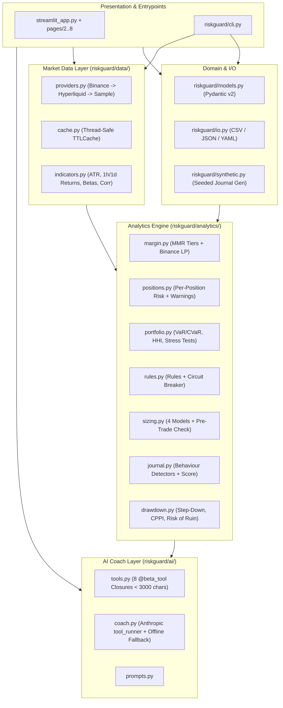

# RiskGuard Architecture

## System Design Overview

RiskGuard separates pure quantitative analytics, resilient market-data ingestion, AI tool orchestration, and presentation into modular layers with zero circular dependencies and read-only guarantees.

---

## Directory Structure

- `streamlit_app.py` + `pages/2_*.py .. 8_*.py`: Multipage Streamlit application styled with the Crypto Quant Suite dark theme (`.streamlit/config.toml`).
- `riskguard/models.py`: Strict Pydantic v2 models (`AccountState`, `PositionInput`, `JournalTrade`, `RuleConfig`, and typed analytics outputs).
- `riskguard/io.py`: Parsers and serializers for positions (CSV/JSON/DataFrame), journals (CSV), and rules (YAML).
- `riskguard/data/`:
  - `providers.py`: `MarketDataProvider` implementing Binance USDT-M REST (`premiumIndex`, `ticker/24hr`, `klines`) with backoff on HTTP 429 (honouring `Retry-After`), automatic fallback on HTTP 451 / other HTTP errors / network errors / malformed payloads to Hyperliquid (`metaAndAssetCtxs`, `candleSnapshot`), and offline fallback to `data/sample/{SYMBOL}_1h.csv.gz`. Symbols missing from a live feed are listed in the bundle's reason and are not back-filled with stale sample prices.
  - `cache.py`: Thread-safe TTL cache (no Parquet/Numba dependencies).
  - `indicators.py`: Daily resampling (a still-forming last UTC day is dropped), Wilder ATR(14), 30d/90d hourly correlations, and 90d hourly BTC betas.
- `riskguard/analytics/`: Pure deterministic quantitative modules with zero network or UI coupling.
- `riskguard/ai/`:
  - `tools.py`: `build_coach_tools(ctx)` creates 8 `@beta_tool` closures over `CoachContext`, each returning compact JSON strictly under 3,000 characters.
  - `coach.py`: Invokes `client.beta.messages.tool_runner` (`claude-opus-5-5`, `effort="high"`, `betas=["server-side-fallback-2026-07-01"]`, `fallbacks="default"`), handles `stop_reason == "refusal"` and Anthropic API exceptions cleanly, and provides a deterministic offline briefing without an API key.
- `riskguard/ui/`: Shared dark CSS theme, sidebar controls (mode toggle, equity, load demo, session-only password API key, data-source badge), session state caching, and Plotly charts.
- `tests/`: Unit tests for every math/behavioural module, JSON fixture provider tests with mocked HTTP, zero-key AI tool + mocked `tool_runner` tests, CLI verification, and `streamlit.testing.v1.AppTest` E2E tests across all 8 pages. `tests/test_independent_verification.py` re-derives every formula from hand-calculated values and drives every page's main widgets.
